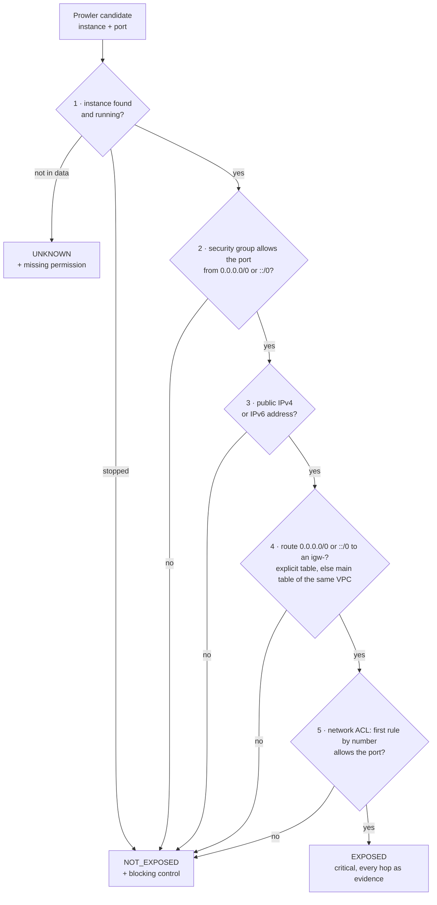
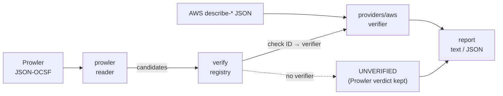

# cloud-scanner-task

A small proof of concept for the Aikido Cloud Security Case. It takes Prowler's
"port open to the internet" findings and **proves** whether the instance can really be
reached from the internet. Every verdict comes with the evidence path and a fix.

Prowler flags an EC2 instance when one of its security groups allows SSH from `0.0.0.0/0`.
That is a configuration fact, not exposure. To reach the instance, a packet also needs a
public address, a route to an internet gateway, and a network ACL that lets it in. This
tool walks that path for every Prowler candidate and answers:

| Verdict | Meaning |
|---|---|
| `EXPOSED` | Every hop is open. The evidence lists each one. |
| `NOT_EXPOSED` | All data is present and a control blocks the path. The result names the control, e.g. "network ACL rule 90". |
| `UNKNOWN` | Data or permissions are missing. The result names what is missing. It is never reported as a pass. |

## 1. Three proposed checks

| # | Check | Customer risk | Why this priority |
|---|---|---|---|
| 1 | **Verified internet exposure of admin and data ports** (implemented) | Direct remote access to SSH, RDP or a database port. | It's the most common entry point, and it is what a new pre-auth RCE turns into a breach overnight (see Aikido's posts on the [Apache HTTP/2](https://www.aikido.dev/blog/cve-2026-119618-apache-http-server-rce) and [Linux TCP](https://www.aikido.dev/blog/linux-kernel-tcp-rce-vulnerability-cve-2026-98432) RCEs). Today's checks are noisy here: they flag security groups, not reachability. Proving the path removes false positives, in the same spirit as "[only proven findings make the report](https://www.aikido.dev/blog/aikido-launches-external-network-pentesting)". |
| 2 | **Exposed workload with IMDSv1 and a powerful IAM role** | One SSRF bug on a public instance leaks its role credentials. If the role is admin, or can escalate (`iam:PassRole` + `ec2:RunInstances`, `iam:Attach*Policy`...), the attacker owns the account. | This is the network × identity interaction. It reuses check 1's path, so it is the natural next step. |
| 3 | **Risky role trust** | Roles that outsiders can assume with no network path at all: `Principal: *`, third-party trust without `sts:ExternalId`, GitHub OIDC trust with no or a wildcard `sub` condition. | The [wfx-loot campaign](https://www.aikido.dev/blog/compromised-github-accounts-push-ci-secret-stealer-to-tens-of-thousands-of-repositories) swapped stolen GitHub OIDC tokens for cloud sessions and rewrote trust policies to `"Principal": {"AWS": "*"}`. That persists after every secret is rotated, so only a posture check finds it. |

## 2. Chosen check and approach

**Check 1**, starting with the Prowler checks `ec2_instance_port_ssh_exposed_to_internet` (22) and
`ec2_instance_port_rdp_exposed_to_internet` (3389). Prowler has the same check for 15+ other
ports, and each one is a single line in the verifier's port map.

### Why build on Prowler

Prowler already finds the candidates across many ports and across AWS, Azure and GCP. This tool
does not compete with it; it removes its false positives. Reading Prowler 5.50.0's source shows
three gaps in these checks:

- An instance with **no public IP** is still a `FAIL` (severity medium):
  [`ec2/lib/instance.py`](https://github.com/prowler-cloud/prowler/blob/5.50.0/prowler/providers/aws/services/ec2/lib/instance.py#L18-L19).
- **Network ACLs are not considered**, so a subnet whose ACL denies port 22 is still `critical`.
- When a subnet has no explicit route table, the fallback queries `association.main=true` for the
  **whole region, not the subnet's VPC**:
  [`vpc/vpc_service.py`](https://github.com/prowler-cloud/prowler/blob/5.50.0/prowler/providers/aws/services/vpc/vpc_service.py#L365).
  Another VPC's main table can then mark the subnet public.

The input is Prowler's **JSON-OCSF** output, not its CSV. OCSF is an open, versioned schema that
keeps nested data as real fields, and it looks the same for every cloud. CSV is read by column
name, so a renamed column breaks parsing silently.

### Data sources, APIs and permissions

| Data | Read-only API | Permission |
|---|---|---|
| Candidates | `prowler aws --checks <ids> -M json-ocsf` | the Prowler role |
| Instances: state, public IPv4, IPv6, subnet, VPC, security groups | `DescribeInstances` | `ec2:DescribeInstances` |
| Security group ingress rules | `DescribeSecurityGroups` | `ec2:DescribeSecurityGroups` |
| Route tables and their associations | `DescribeRouteTables` | `ec2:DescribeRouteTables` |
| Network ACL entries and their associations | `DescribeNetworkAcls` | `ec2:DescribeNetworkAcls` |

All four are in the AWS managed `SecurityAudit` policy. The fixtures in `examples/` are exactly
what `aws ec2 describe-* --output json` prints. They load straight into the AWS SDK for Go types,
so a live read-only collector produces the same data.

### The verification walk



Each hop is checked per address family (IPv4 and IPv6). The instance is exposed if either family
passes every hop. Missing data at any hop gives `UNKNOWN`, never `NOT_EXPOSED`.

### Architecture



Only `internal/providers/aws` knows about AWS. Supporting another cloud means adding a verifier
under `internal/providers/` for that cloud's Prowler checks. The reader, registry and report
stay unchanged.

```
cmd/scanner/            entry point: flags, exit codes
internal/
  finding/              shared types: Candidate, Result, Status
  prowler/              IN    read Prowler JSON-OCSF (any cloud)
  verify/               CORE  Verifier interface and registry
  providers/aws/        AWS   inventory and the five-hop walk
  report/               OUT   text and JSON
examples/               demo account snapshots
```
