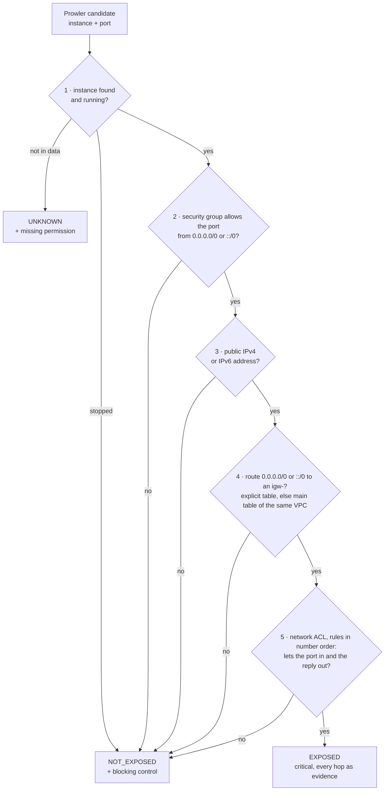
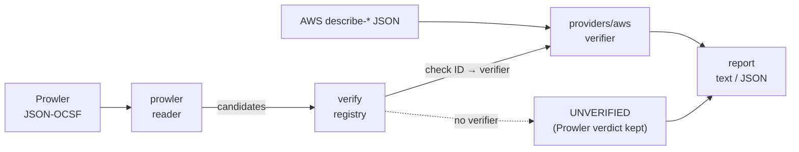
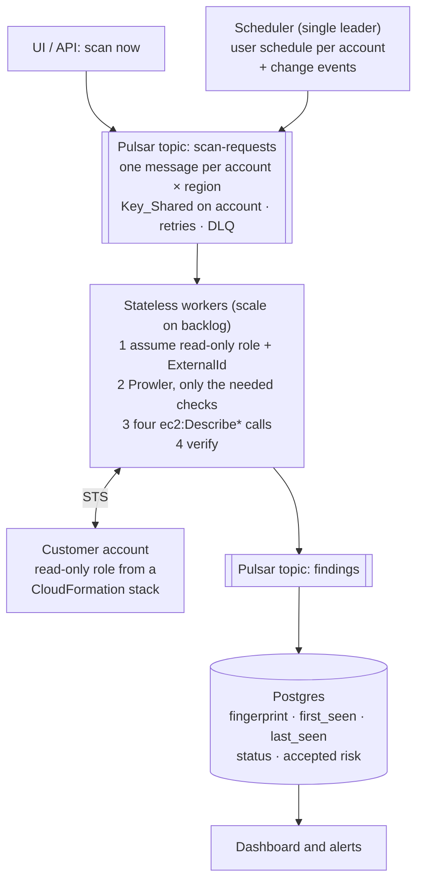

# cloud-scanner-task

[](https://github.com/jnathangreeg/cloud-scanner-task/actions/workflows/ci.yml)

A small proof of concept for the Aikido Cloud Security Case. It takes Prowler's
"port open to the internet" findings and **proves** whether the instance can really be
reached from the internet. Every verdict comes with the evidence path and a fix.

Prowler flags an EC2 instance when one of its security groups allows SSH from `0.0.0.0/0`.
That is a configuration fact, not exposure. To reach the instance, a packet also needs a
public address, a route to an internet gateway, and a network ACL that lets it in. This
tool walks that path for every Prowler candidate and answers:

| Verdict | Meaning |
|---|---|
| `EXPOSED` | Every hop is open. The evidence lists each one. |
| `NOT_EXPOSED` | A control blocks the path, proven with collected data. The result names the control, e.g. "network ACL rule 90". |
| `UNKNOWN` | Data or permissions needed to decide are missing. The result names what is missing and fails the run by default. |

## 1. Three proposed checks

| # | Check | Customer risk | Why this priority |
|---|---|---|---|
| 1 | **Verified internet exposure of admin and data ports** (implemented) | Direct remote access to SSH, RDP or a database port. | It's the most common entry point, and it is what a new pre-auth RCE turns into a breach overnight (see Aikido's posts on the [Apache HTTP/2](https://www.aikido.dev/blog/cve-2026-119618-apache-http-server-rce) and [Linux TCP](https://www.aikido.dev/blog/linux-kernel-tcp-rce-vulnerability-cve-2026-98432) RCEs). Today's checks are noisy here: they flag security groups, not reachability. Proving the path removes false positives, in the same spirit as "[only proven findings make the report](https://www.aikido.dev/blog/aikido-launches-external-network-pentesting)". |
| 2 | **Exposed workload with IMDSv1 and a powerful IAM role** | One SSRF bug on a public instance leaks its role credentials. If the role is admin, or can escalate (`iam:PassRole` + `ec2:RunInstances`, `iam:Attach*Policy`...), the attacker owns the account. | This is the network × identity interaction. It reuses check 1's path, so it is the natural next step. |
| 3 | **Risky role trust** | Roles that outsiders can assume with no network path at all: `Principal: *`, third-party trust without `sts:ExternalId`, GitHub OIDC trust with no or a wildcard `sub` condition. | The [wfx-loot campaign](https://www.aikido.dev/blog/compromised-github-accounts-push-ci-secret-stealer-to-tens-of-thousands-of-repositories) swapped stolen GitHub OIDC tokens for cloud sessions and rewrote trust policies to `"Principal": {"AWS": "*"}`. That persists after every secret is rotated, so only a posture check finds it. |

## 2. Chosen check and approach

**Check 1**, starting with the Prowler checks `ec2_instance_port_ssh_exposed_to_internet` (22) and
`ec2_instance_port_rdp_exposed_to_internet` (3389). Prowler has the same check for 15+ other
ports, and each one is a single line in the verifier's port map.

### Why build on Prowler

Prowler already finds the candidates across many ports and across AWS, Azure and GCP. This tool
does not compete with it; it removes its false positives. Reading Prowler 5.50.0's source shows
three gaps in these checks:

- An instance with **no public IP** is still a `FAIL` (severity medium):
  [`ec2/lib/instance.py`](https://github.com/prowler-cloud/prowler/blob/5.50.0/prowler/providers/aws/services/ec2/lib/instance.py#L18-L19).
- **Network ACLs are not considered**, so a subnet whose ACL denies port 22 is still `critical`.
- When a subnet has no explicit route table, the fallback queries `association.main=true` for the
  **whole region, not the subnet's VPC**:
  [`vpc/vpc_service.py`](https://github.com/prowler-cloud/prowler/blob/5.50.0/prowler/providers/aws/services/vpc/vpc_service.py#L365).
  Another VPC's main table can then mark the subnet public.

The input is Prowler's **JSON-OCSF** output, not its CSV. OCSF is an open, versioned schema that
keeps nested data as real fields, and it looks the same for every cloud. CSV is read by column
name, so a renamed column breaks parsing silently.

### Data sources, APIs and permissions

| Data | Read-only API | Permission |
|---|---|---|
| Candidates | `prowler aws --checks <ids> -M json-ocsf` | the Prowler role |
| Instances: state, public IPv4, IPv6, subnet, VPC, security groups | `DescribeInstances` | `ec2:DescribeInstances` |
| Security group ingress rules | `DescribeSecurityGroups` | `ec2:DescribeSecurityGroups` |
| Route tables and their associations | `DescribeRouteTables` | `ec2:DescribeRouteTables` |
| Network ACL entries and their associations | `DescribeNetworkAcls` | `ec2:DescribeNetworkAcls` |

All four are in the AWS managed `SecurityAudit` policy. The fixtures in `examples/` are exactly
what `aws ec2 describe-* --output json` prints. They load straight into the AWS SDK for Go types,
so a live read-only collector produces the same data.

### The verification walk



Each hop is checked per address family (IPv4 and IPv6). The instance is exposed if either family
passes every hop. Missing data at a hop gives `UNKNOWN`, never `NOT_EXPOSED`. A hop that already
blocks with real data still gives `NOT_EXPOSED`, because nothing after it can reopen the path.

### Architecture



Only `internal/providers/aws` knows about AWS. Supporting another cloud means adding a verifier
under `internal/providers/` for that cloud's Prowler checks. The reader, registry and report
stay unchanged.

```
cmd/scanner/            entry point: flags, exit codes
internal/
  finding/              shared types: Candidate, Result, Status
  prowler/              IN    read Prowler JSON-OCSF (any cloud)
  verify/               CORE  Verifier interface and registry
  providers/aws/        AWS   inventory and the five-hop walk
  report/               OUT   text and JSON
examples/               demo account snapshots
```

## 3. Run it

Only Go is needed (no AWS account, no Python, no Docker). It runs on Linux, macOS and Windows, and
CI tests all three.

```bash
git clone https://github.com/jnathangreeg/cloud-scanner-task && cd cloud-scanner-task
go run ./cmd/scanner --prowler examples/demo-account/prowler.ocsf.json --inventory examples/demo-account/aws
go test ./...
```

With `make`: `make run-demo` (the same run with `--fail-on never`, so it exits 0), `make test` (with
the race detector, which needs cgo), `make lint` and `make cover`.

| Flag | Meaning |
|---|---|
| `--prowler` | Prowler JSON-OCSF findings file |
| `--inventory` | directory with the `aws ec2 describe-*` JSON files |
| `--format` | `text` (default) or `json` |
| `--fail-on` | exit 1 on `unknown` (EXPOSED or UNKNOWN, the default), `exposed` (EXPOSED only), or `never` |

Exit codes: `0` nothing at the threshold, `1` findings at the threshold, `2` usage error, `3` input
error or interrupted run. By default an `UNKNOWN` fails the run, because missing data is never a pass.

### The demo account

`examples/demo-account` is one AWS account with five instances. All five have a security group that
opens SSH to the internet, and Prowler fails all five. Only the path behind the security group differs.

| Instance | Setup | Prowler | This tool |
|---|---|---|---|
| `i-0web` | public IP, public subnet, network ACL allows all | critical | **EXPOSED** |
| `i-0nacl` | same as `i-0web`, but its subnet's ACL rule 90 denies port 22 | critical | **NOT_EXPOSED** (ACL rule 90) |
| `i-0private` | no public IP, NAT route only | medium | **NOT_EXPOSED** (no public address) |
| `i-0othervpc` | public IP; subnet has no route table association, and its VPC's main table has no internet route (another VPC's main table does) | critical | **NOT_EXPOSED** (no internet route) |
| `i-0v6` | no public IPv4, but an IPv6 address, `::/0` in the security group and a `::/0` route to the internet gateway | medium | **EXPOSED** over IPv6 |

The demo also has a failed Prowler check with no verifier (`ec2_instance_profile_attached`). It is
kept as `UNVERIFIED` with Prowler's own severity, so nothing is silently dropped.

**Finding and look-alike.** `i-0web` and `i-0nacl` have the same security group, the same kind of
public IP and the same route table. Only the network ACL differs:

```
[EXPOSED] critical  arn:aws:ec2:eu-west-1:123456789012:instance/i-0web
  check: ec2_instance_port_ssh_exposed_to_internet (Prowler said critical)
  tcp/22 is reachable from the internet at 203.0.113.10 (IPv4, from 0.0.0.0/0)
    ✔ instance        i-0web        running
    ✔ security group  sg-0ssh       allows tcp/22 from 0.0.0.0/0
    ✔ public address  203.0.113.10  public IPv4 on i-0web
    ✔ route table     rtb-0pub      0.0.0.0/0 → igw-0a
    ✔ network ACL     acl-0a        inbound rule 100 allows tcp/22 from 0.0.0.0/0; outbound rule 100 allows the return traffic
  fix:
    - Remove or narrow the 0.0.0.0/0 rule on sg-0ssh: aws ec2 revoke-security-group-ingress --group-id sg-0ssh --ip-permissions 'IpProtocol=tcp,FromPort=22,ToPort=22,IpRanges=[{CidrIp=0.0.0.0/0}]'
    - Prefer AWS Systems Manager Session Manager over inbound SSH/RDP, so no inbound port is needed.

[NOT_EXPOSED] info  arn:aws:ec2:eu-west-1:123456789012:instance/i-0nacl
  check: ec2_instance_port_ssh_exposed_to_internet (Prowler said critical)
  not reachable from the internet. IPv4: network ACL acl-0locked: inbound rule 90 denies tcp/22 from the internet. IPv6: public address i-0nacl: no public IPv6 address
    ✔ instance        i-0nacl       running
    ✔ security group  sg-0ssh       allows tcp/22 from 0.0.0.0/0
    ✔ public address  203.0.113.20  public IPv4 on i-0nacl
    ✔ route table     rtb-0pub      0.0.0.0/0 → igw-0a
    ✘ network ACL     acl-0locked   inbound rule 90 denies tcp/22 from the internet
  fix:
    - Defense in depth: sg-0ssh still allows tcp/22 from 0.0.0.0/0, so one change to an address, route or network ACL would expose it: aws ec2 revoke-security-group-ingress --group-id sg-0ssh --ip-permissions 'IpProtocol=tcp,FromPort=22,ToPort=22,IpRanges=[{CidrIp=0.0.0.0/0}]'
    - Defense in depth: sg-0ssh still allows tcp/22 from ::/0, so one change to an address, route or network ACL would expose it: aws ec2 revoke-security-group-ingress --group-id sg-0ssh --ip-permissions 'IpProtocol=tcp,FromPort=22,ToPort=22,Ipv6Ranges=[{CidrIpv6=::/0}]'
```

`NOT_EXPOSED` still suggests a fix. The security group is a latent risk, but it is no longer a
critical alert. Severity follows what is really reachable: `critical` when the reachable range is
broad (`/8` or wider for IPv4, `/32` for IPv6, the thresholds S3 uses for "public"), `high` when a
network ACL narrows it to a smaller range such as one office `/24`.

### Missing permissions

`examples/missing-permission` is the same `i-0web`, but the scanner role was denied
`ec2:DescribeNetworkAcls` (recorded in `errors.json`):

```
[UNKNOWN] critical  arn:aws:ec2:eu-west-1:123456789012:instance/i-0web
  check: ec2_instance_port_ssh_exposed_to_internet (Prowler said critical)
  cannot conclude: network ACL data is missing. Keeping Prowler's severity.
  fix:
    - Grant the scanner role the missing read-only permissions (all are in the AWS managed SecurityAudit policy) and rescan.
  missing:
    - ec2:DescribeNetworkAcls (AccessDenied)
```

### Running it on a real account

All calls are read-only. With a profile that has `SecurityAudit`:

```bash
prowler aws --region eu-west-1 -M json-ocsf \
  --checks ec2_instance_port_ssh_exposed_to_internet ec2_instance_port_rdp_exposed_to_internet
mkdir snapshot
for api in instances security-groups route-tables network-acls; do
  aws ec2 describe-$api --region eu-west-1 --output json > snapshot/describe-$api.json
done
go run ./cmd/scanner --prowler "$(ls -t output/*.ocsf.json | head -1)" --inventory snapshot
```

If a `describe-*` call is denied, leave its file out or record it in `snapshot/errors.json`. The
affected checks then report `UNKNOWN`, name the missing action and say whether to grant a
permission (AccessDenied) or just collect again.

## 4. Limits

The verdict covers the direct internet path to the instance's own address. Things that can change it:

- **Other ways in:** an internet-facing load balancer, NAT port forwarding, Global Accelerator or
  CloudFront in front of a private instance. These need the ELBv2 and target-group data.
- **Security group sources:** like Prowler, only rules from `0.0.0.0/0` or `::/0` count. Managed
  prefix lists, references to other security groups and narrower CIDRs are not treated as the internet.
  Network ACLs are evaluated with real address-range math, so narrow and split ACL rules are handled.
- **Return traffic:** network ACLs are stateless, so the outbound rules must allow the reply. This
  is checked with one representative ephemeral port (49152, inside every common OS range).
- **Controls outside the VPC configuration:** a host firewall, AWS Network Firewall or a Gateway
  Load Balancer appliance in the route path, and whether anything listens on the port.
- **Non-internet exposure:** VPC peering, Transit Gateway, VPN and Direct Connect.
- **Time:** the verdict describes one snapshot. A security group or route can change minutes later.

**Missing data or permissions** never produce a pass. The result is `UNKNOWN`, keeps Prowler's
severity, names the missing API action (or the missing piece, such as a subnet with no network
ACL in the snapshot), and fails the run by default. A hop that blocks with real data still gives a valid
`NOT_EXPOSED`, even when later data is missing, because nothing after a blocked hop can open the path.

## 5. Production scale: 3,000 environments



- **Fan-out:** one message per account and region, on a queue with retries and a dead-letter
  topic. One broken account cannot block the other 2,999. Keying on the account means two workers
  never scan the same account at once, and workers scale on backlog.
- **Access:** customers deploy a read-only role (CloudFormation or StackSets for a whole
  organization) that trusts the scanner with an `sts:ExternalId`. Workers use short-lived
  credentials per scan, and no keys are stored.
- **Rate limits:** AWS throttles per account and region, so each worker limits its own calls, uses
  the SDK's retry with backoff, and runs only the Prowler checks that have consumers.
- **Findings store:** a finding's identity is a fingerprint of provider, check and resource. Each
  scan upserts `last_seen`. A finding is auto-resolved only after a **complete** scan of that
  account, so a partial scan or an `AccessDenied` never "fixes" findings.
- **Stuck scans:** a running scan holds a lease with a heartbeat, so a crashed worker frees the
  account quickly and the scheduler can skip accounts that are still scanning.
- **Observability:** scan lag, the AccessDenied rate per permission, the verdict mix per check, DLQ size.

**Before production:**

1. A correctness corpus of real VPC topologies, compared against AWS Reachability Analyzer.
2. Reporting of permission gaps to customers.
3. Tenant isolation: fail closed if the account ID in the data is not the expected one.
4. Fuzz tests for the security group and ACL matchers.

## Next steps

1. **Design review with the team.** Write a short design record for the verdict model (EXPOSED,
   NOT_EXPOSED, UNKNOWN and what "evidence" must contain). Present it, debate the trade-offs (how
   much noise to accept versus the risk of missing a real exposure), then agree and build.
2. **Customer onboarding.** A CloudFormation or Terraform template for the read-only role with an
   ExternalId, StackSets for organizations, and versioned permission sets so a new check that needs
   a new permission is detected and the customer is told.
3. **Continuous scanning.** "Scan now", a schedule per account set by the user, and rescans
   triggered by change events (EventBridge or AWS Config on security group, ACL and route changes),
   so a new exposure is found in minutes.
4. **Risk acceptance and false positives.** Let a user mark a finding as accepted risk or false
   positive with a reason, an owner, a scope and an expiry date. The finding stays visible as
   accepted, reopens when the date passes, and every change is audit-logged.
5. **Input at scale.** Stream-decode large OCSF files instead of loading them whole, pin the OCSF
   schema version, and accept findings from other OCSF producers such as Security Hub.
6. **Checks 2 and 3**, starting from this check's path result.
7. **A live read-only collector** with the AWS SDK for Go, producing the same types as the fixtures.
8. **More paths:** load balancers, prefix lists, per-interface security groups for every Prowler
   port check, and ACL return traffic for unusual ephemeral port ranges.
9. **Azure:** a verifier for Prowler's network security group checks, under `internal/providers/azure`.
