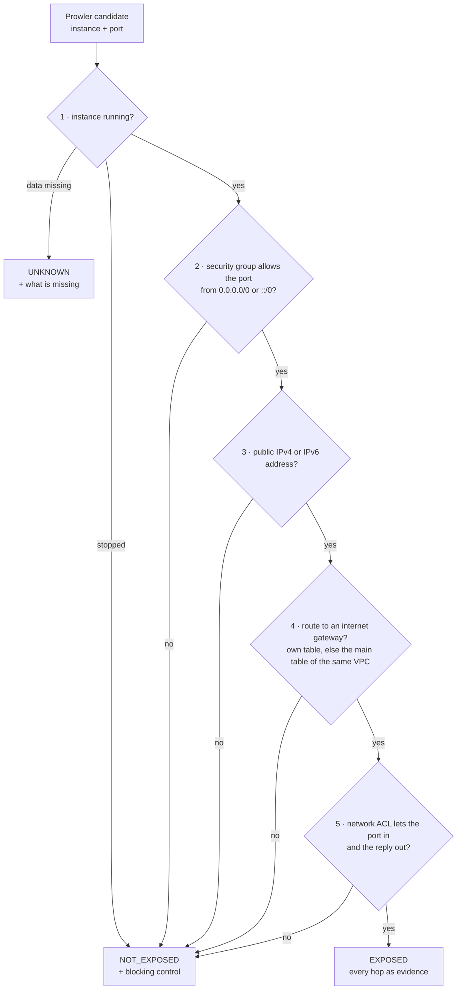
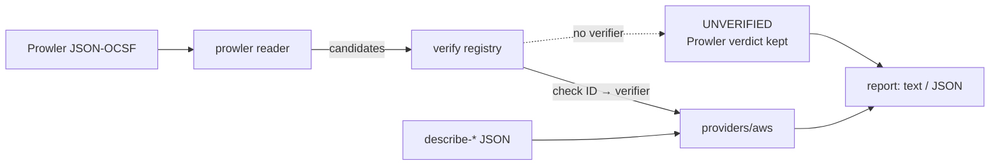
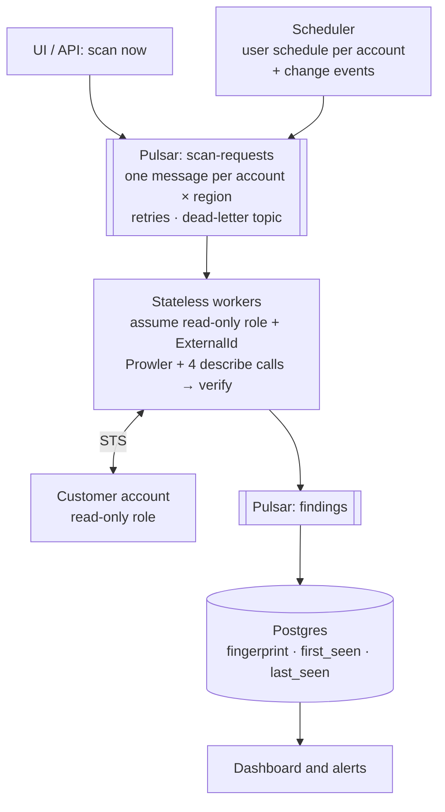

# cloud-scanner-task

[](https://github.com/jnathangreeg/cloud-scanner-task/actions/workflows/ci.yml)

A small proof of concept for the Aikido Cloud Security Case.

Prowler flags an EC2 instance when a security group allows SSH from `0.0.0.0/0`. That is a
configuration fact, not exposure: a packet also needs a public address, a route to an internet
gateway and a network ACL that lets it in. This tool takes Prowler's findings, walks that path,
and **proves** the answer with evidence and a fix:

| Verdict | Meaning |
|---|---|
| `EXPOSED` | Every hop is open. Each hop is listed as evidence. |
| `NOT_EXPOSED` | A control blocks the path, proven with collected data, e.g. "network ACL rule 90". |
| `UNKNOWN` | Data or permissions are missing. It names what is missing and is never treated as a pass. |

## Quick start

Only Go is needed. No AWS account, Python or Docker. CI runs on Linux, macOS and Windows.

```bash
git clone https://github.com/jnathangreeg/cloud-scanner-task && cd cloud-scanner-task
go run ./cmd/scanner --prowler examples/demo-account/prowler.ocsf.json --inventory examples/demo-account/aws
go test ./...
```

## 1. Three proposed checks

| # | Check | Customer risk | Why this priority |
|---|---|---|---|
| 1 | **Verified internet exposure of admin ports** (built) | Remote access to SSH, RDP or a database. | The most common way in, and the first question when a pre-auth RCE drops ([Apache HTTP/2](https://www.aikido.dev/blog/cve-2026-119618-apache-http-server-rce), [Linux TCP](https://www.aikido.dev/blog/linux-kernel-tcp-rce-vulnerability-cve-2026-98432)). Today's checks flag security groups, not reachability, so proving the path removes noise. Same idea as "[only proven findings make the report](https://www.aikido.dev/blog/aikido-launches-external-network-pentesting)". |
| 2 | **Exposed instance with IMDSv1 and a powerful role** | One SSRF on a public instance leaks role credentials; an admin or escalating role means account takeover. | Network × identity. It reuses check 1's path. |
| 3 | **Risky role trust** | Outsiders assume roles with no network path: `Principal: *`, no `sts:ExternalId`, GitHub OIDC without a fixed `sub`. | The [wfx-loot campaign](https://www.aikido.dev/blog/compromised-github-accounts-push-ci-secret-stealer-to-tens-of-thousands-of-repositories) rewrote trust policies to `"Principal": {"AWS": "*"}`, which survives secret rotation. |

## 2. Approach

**Why build on Prowler.** Prowler already finds the candidates for 15+ ports on AWS, Azure and
GCP. This tool removes its false positives instead of replacing it. Prowler 5.50.0's own code shows
three gaps in these checks:

- An instance with **no public IP** still fails, at medium ([`instance.py`](https://github.com/prowler-cloud/prowler/blob/5.50.0/prowler/providers/aws/services/ec2/lib/instance.py#L18-L19)).
- **Network ACLs are ignored**, so a subnet that denies port 22 still shows `critical`.
- A subnet without its own route table falls back to the main table of **any VPC in the region**,
  not its own ([`vpc_service.py`](https://github.com/prowler-cloud/prowler/blob/5.50.0/prowler/providers/aws/services/vpc/vpc_service.py#L365)).

**Input.** Prowler's JSON-OCSF output (the same open format for every cloud), plus four read-only
EC2 calls. The fixtures in `examples/` are exactly what `aws ec2 describe-* --output json` prints,
and they load straight into the AWS SDK for Go types.

| Data | Read-only API (all in `SecurityAudit`) |
|---|---|
| Candidates | `prowler aws --checks <ids> -M json-ocsf` |
| Instances: state, addresses, interfaces, security groups | `ec2:DescribeInstances` |
| Security group rules | `ec2:DescribeSecurityGroups` |
| Route tables | `ec2:DescribeRouteTables` |
| Network ACLs | `ec2:DescribeNetworkAcls` |

**The walk.** Run per address family (IPv4, IPv6) and per network interface with a public address:



A hop that blocks with real data is a valid `NOT_EXPOSED` even if later data is missing, because
nothing after it can reopen the path. Missing data before that point is always `UNKNOWN`.

**Architecture.** Only `internal/providers/aws` knows about AWS. Another cloud is one more folder
under `internal/providers/`; the reader, registry and report stay the same.



```
cmd/scanner/        CLI: flags and exit codes
internal/finding/   shared types
internal/prowler/   IN    read Prowler JSON-OCSF
internal/verify/    CORE  Verifier interface and registry
internal/providers/aws/   inventory and the five-hop walk
internal/report/    OUT   text and JSON
examples/           demo snapshots
```

## 3. Results

`examples/demo-account` has five instances with the same "SSH open to the world" security group.
Prowler fails all five. Only the path behind the security group differs:

| Instance | Setup | Prowler | This tool |
|---|---|---|---|
| `i-0web` | public IP, public subnet | critical | **EXPOSED** |
| `i-0nacl` | same as `i-0web`, but ACL rule 90 denies port 22 | critical | **NOT_EXPOSED** |
| `i-0private` | no public IP | medium | **NOT_EXPOSED** |
| `i-0othervpc` | no route table of its own; its VPC's main table has no internet route | critical | **NOT_EXPOSED** |
| `i-0v6` | no public IPv4, but IPv6 with `::/0` open and routed | medium | **EXPOSED** (IPv6) |

**The finding and its look-alike.** Same security group, same kind of public IP, same route
table. Only the network ACL differs:

```
[EXPOSED] critical  arn:aws:ec2:eu-west-1:123456789012:instance/i-0web
  check: ec2_instance_port_ssh_exposed_to_internet (Prowler said critical)
  tcp/22 is reachable from the internet at 203.0.113.10 (IPv4, from 0.0.0.0/0)
    ✔ instance        i-0web        running
    ✔ security group  sg-0ssh       allows tcp/22 from 0.0.0.0/0
    ✔ public address  203.0.113.10  public IPv4 on i-0web
    ✔ route table     rtb-0pub      0.0.0.0/0 → igw-0a
    ✔ network ACL     acl-0a        inbound rule 100 allows tcp/22 from 0.0.0.0/0; outbound rule 100 allows the return traffic
  fix:
    - Remove or narrow the 0.0.0.0/0 rule on sg-0ssh: aws ec2 revoke-security-group-ingress --group-id sg-0ssh --ip-permissions 'IpProtocol=tcp,FromPort=22,ToPort=22,IpRanges=[{CidrIp=0.0.0.0/0}]'
    - Prefer AWS Systems Manager Session Manager over inbound SSH/RDP, so no inbound port is needed.

[NOT_EXPOSED] info  arn:aws:ec2:eu-west-1:123456789012:instance/i-0nacl
  check: ec2_instance_port_ssh_exposed_to_internet (Prowler said critical)
  not reachable from the internet. IPv4: network ACL acl-0locked: inbound rule 90 denies tcp/22 from the internet. IPv6: public address i-0nacl: no public IPv6 address
    ✔ instance        i-0nacl       running
    ✔ security group  sg-0ssh       allows tcp/22 from 0.0.0.0/0
    ✔ public address  203.0.113.20  public IPv4 on i-0nacl
    ✔ route table     rtb-0pub      0.0.0.0/0 → igw-0a
    ✘ network ACL     acl-0locked   inbound rule 90 denies tcp/22 from the internet
```

`NOT_EXPOSED` still lists a "defense in depth" fix for the open security group (left out above).
Severity follows what is really reachable: `critical` for a broad range (`/8` or wider), `high`
when an ACL narrows it to something like one office `/24`.

**Missing permission.** `examples/missing-permission` is the same `i-0web` with
`ec2:DescribeNetworkAcls` denied:

```
[UNKNOWN] critical  arn:aws:ec2:eu-west-1:123456789012:instance/i-0web
  check: ec2_instance_port_ssh_exposed_to_internet (Prowler said critical)
  cannot conclude: network ACL data is missing. Keeping Prowler's severity.
  fix:
    - Grant the scanner role the missing read-only permissions (all are in the AWS managed SecurityAudit policy) and rescan.
  missing:
    - ec2:DescribeNetworkAcls (AccessDenied)
```

### Usage

| Flag | Meaning |
|---|---|
| `--prowler` | Prowler JSON-OCSF file |
| `--inventory` | folder with the `describe-*.json` files (and an optional `errors.json` of failed calls) |
| `--format` | `text` (default) or `json` |
| `--fail-on` | exit 1 on `unknown` (EXPOSED or UNKNOWN, the default), `exposed`, or `never` |

Exit codes: `0` clean, `1` findings, `2` usage error, `3` input error or interrupted run.
`make test` (race detector), `make lint` and `make cover` are also available.

**On a real account** (read-only, a profile with `SecurityAudit`):

```bash
prowler aws --region eu-west-1 -M json-ocsf \
  --checks ec2_instance_port_ssh_exposed_to_internet ec2_instance_port_rdp_exposed_to_internet
mkdir snapshot
for api in instances security-groups route-tables network-acls; do
  aws ec2 describe-$api --region eu-west-1 --output json > snapshot/describe-$api.json
done
go run ./cmd/scanner --prowler "$(ls -t output/*.ocsf.json | head -1)" --inventory snapshot
```

## 4. Limits and assumptions

What can change the verdict:

- **Other ways in:** an internet-facing load balancer, Global Accelerator or CloudFront in front of the instance.
- **Controls outside the VPC config:** host firewalls, AWS Network Firewall, and whether anything listens on the port.
- **Non-internet exposure:** VPC peering, Transit Gateway, VPN.
- **Time:** the verdict describes one snapshot.

Assumptions:

- Like Prowler, a security group counts only for rules from `0.0.0.0/0` or `::/0`. Prefix lists and
  references to other security groups are not the internet.
- Network ACLs are evaluated with real address-range math, including the stateless reply, checked
  on one representative ephemeral port (49152).

**Missing data or permissions** give `UNKNOWN`, keep Prowler's severity, name what is missing,
and fail the run by default. They never count as a pass.

## 5. Production scale: 3,000 environments



- **Fan-out:** one message per account and region. Retries and a dead-letter topic mean one broken
  account cannot block the other 2,999, and workers scale on the queue backlog.
- **Access:** a read-only role per customer (CloudFormation, or StackSets for a whole organization)
  trusted with an `sts:ExternalId`. Short-lived credentials per scan, no stored keys.
- **Rate limits:** AWS throttles per account and region, so workers cap their own calls, retry
  with backoff, and run only the Prowler checks that are needed.
- **Findings store:** a finding's fingerprint (provider, check, resource) tracks first and last
  seen. Findings auto-resolve only after a **complete** scan, so an `AccessDenied` never "fixes" anything.
- **Reliability:** a running scan holds a lease with a heartbeat, so a crashed worker frees the account fast.

Before production: test the verdicts against AWS Reachability Analyzer on real VPC topologies,
show permission gaps to customers, and fail closed if the data belongs to a different account
than expected.

## Next steps

In priority order:

1. **Design review with the team.** Write a design record for the scale design above and the
   verdict model, present it, and debate the trade-offs (noise versus the risk of missing a real
   exposure) before building.
2. **Production path.** The customer onboarding role, a live read-only collector with the AWS SDK
   for Go, and continuous scanning: "scan now", a schedule per account, and rescans when a security
   group, ACL or route changes.
3. **Risk acceptance.** Mark a finding as accepted or a false positive, with a reason, owner and
   expiry date. It stays visible and reopens when the date passes.
4. **More paths:** load balancers, prefix lists and the other Prowler port checks.
5. **Checks 2 and 3**, built on this check's path result.
6. **Azure and GCP:** one verifier each under `internal/providers/`.
